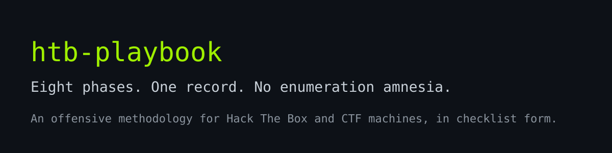

# htb-playbook

[](https://github.com/Epsilon0xCell/htb-playbook/releases) [](LICENSE) [](https://github.com/Epsilon0xCell/htb-playbook/stargazers)



**You do not lose boxes to missing knowledge. You lose them to a service you half-enumerated, a lead you chased an hour too long, and notes that cannot tell you what you already tried. This playbook is built against those three losses.**

It is an offensive methodology for Hack The Box machines, CTF boxes, and authorised red-team work, in the shape of PayloadsAllTheThings: a navigable set of checklists you open mid-engagement, not a course you read once. Eight phases in order, a decision layer that scores leads and kills rabbit holes, four technique modules that run on signal, and the templates that make the record write itself.

For authorised use only: lab platforms, CTFs, and engagements with written permission.

## Use it

```sh
git clone https://github.com/Epsilon0xCell/htb-playbook.git
```

Open [`phases/00-setup.md`](phases/00-setup.md), copy [`templates/box-note.md`](templates/box-note.md) into your box directory, and work the phases in order. Reporting is continuous: the record is written during the box, and the last phase is review, not write-up-from-memory.

[Back to top](#contents)

## Contents

- [Use it](#use-it)
- [The eight phases](#the-eight-phases)
- [The decision layer](#the-decision-layer)
- [The modules](#the-modules)
- [Honest limits](#honest-limits)
- [Contributing](#contributing)
- [License](#license)

## The eight phases

| Phase | Job | File |
|---|---|---|
| 0 | Setup: the record exists before any packet is sent | [00-setup](phases/00-setup.md) |
| 1 | External enumeration: the whole surface, counted | [01-external-enumeration](phases/01-external-enumeration.md) |
| 2 | Per-service enumeration: a fixed order, an exhausted line per service | [02-per-service-enumeration](phases/02-per-service-enumeration.md) |
| 3 | Foothold: scored leads, a stabilised shell, independently confirmed | [03-foothold](phases/03-foothold.md) |
| 4 | Internal enumeration: the full checklist again, from the new vantage point | [04-internal-enumeration](phases/04-internal-enumeration.md) |
| 5 | Privilege escalation: verified leads, scored, never scanner-ordered | [05-privilege-escalation](phases/05-privilege-escalation.md) |
| 6 | The AD path: policy arithmetic, ADCS early, relay gate, DCSync endgame | [06-ad-path](phases/06-ad-path.md) |
| 7 | Writeup and review: lessons extracted, playbook changes proposed | [07-writeup-review](phases/07-writeup-review.md) |

[Back to top](#contents)

## The decision layer

[`decision-layer.md`](decision-layer.md) is the part most methodologies do not have:

- A prioritisation formula, `(E x C x R) / (H x (1 + K))`, scored at the end of enumeration and again at every foothold.
- A two-signal rabbit-hole rule with per-tier backstops, replacing the flat 30-minute clock that both abandons live leads and funds dead ones.
- A difficulty scaling table: how enumeration depth, switch triggers, and hint discipline change from Easy to Insane to Pro Lab.
- Standing rules: two-stage scanning, re-enumeration after every privilege change, independent confirmation of findings, and no duplicate attempt without a written delta.

[Back to top](#contents)

## The modules

Run on signal, not as sweeps: [web and API depth](modules/web-api.md), [pwn and reversing triage](modules/pwn-reversing.md), [crypto misuse](modules/crypto-misuse.md), and [multi-host pivoting](modules/pivoting.md). Plus the [command reference](reference/commands.md) keyed to the phases, and both [templates](templates/).

[Back to top](#contents)

## Honest limits

- The scoring weights and time budgets are operator-fit parameters, stated as such in the decision layer. No source validates them; you fit them from your own calibration log over your first boxes.
- The playbook organises work you still have to know how to do. It links the depth references (HackTricks, the OWASP guides, GTFOBins) rather than copying them.
- It is tuned for one operator, with or without AI agents working the same record. Large-team coordination needs more than this.

[Back to top](#contents)

## Contributing

Changes come from runs and land as checkable rules, via the post-box review discipline the playbook itself prescribes. See CONTRIBUTING.md.

[Back to top](#contents)

## License

MIT. Written by Gavin Blacklock ([Epsilon0xCell](https://github.com/Epsilon0xCell)), from a private framework built over live Hack The Box work. Companions: [ai-redteam-skills](https://github.com/Epsilon0xCell/ai-redteam-skills) for the agent-driven version of this discipline, and [userspace-vpn-client](https://github.com/Epsilon0xCell/userspace-vpn-client) for getting the tunnel up in the first place when the environment says no.

[Back to top](#contents)
